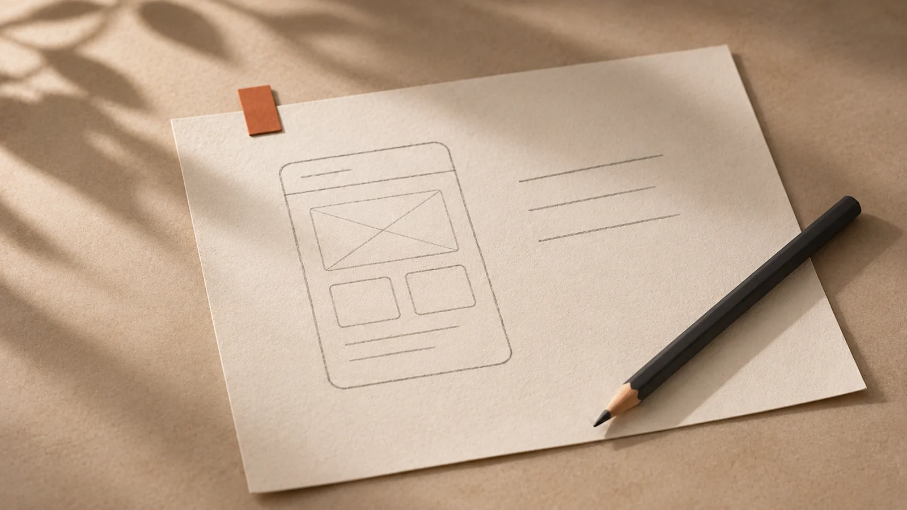

Miałem przygotowaną listę zagadnień, które chciałem omówić. Nie wiedziałem jednak, czy wszystkie będą potrzebne.

Chciałem przede wszystkim zrozumieć, co ta osoba zamierza stworzyć.

I właśnie tak podchodzę do pierwszych rozmów dotyczących realizacji aplikacji.

Nie oczekuję, że przyjdziesz do mnie z gotową dokumentacją techniczną, projektem graficznym, wybraną technologią i odpowiedziami na wszystkie możliwe pytania.

Gdybyś wiedział już dokładnie, jak przeprowadzić cały proces tworzenia aplikacji, prawdopodobnie potrzebowałbyś zupełnie innego rodzaju wsparcia.

**Nie musisz znać wszystkich odpowiedzi przed pierwszą rozmową. Pomoc w ich znalezieniu jest częścią mojej pracy.**

W tym artykule pokażę Ci, co warto przygotować, jak opowiedzieć o swoim pomyśle i czego moim zdaniem powinieneś oczekiwać od pierwszej rozmowy z wykonawcą.

Na końcu znajdziesz również prosty wzór briefu, który możesz wykorzystać do uporządkowania własnych myśli.

## 1. Nie musisz wykonywać pracy specjalisty, zanim się z nim spotkasz

Jeżeli planujesz stworzenie swojej pierwszej aplikacji, naturalnie możesz nie wiedzieć, jak wygląda proces jej realizacji.

Być może zastanawiasz się, czy przed rozmową powinieneś przygotować projekt wszystkich ekranów.

Może nie wiesz, czy aplikacja powinna działać w przeglądarce, czy być dostępna w Google Play i App Store.

A może wydaje Ci się, że powinieneś wcześniej dowiedzieć się czegoś o programowaniu, żeby móc przeprowadzić profesjonalną rozmowę.

Moim zdaniem nie ma takiej potrzeby.

Nie oczekuję od klienta, że przed rozpoczęciem współpracy samodzielnie wybierze bazę danych, język programowania albo architekturę systemu.

To są kwestie, w których powinien otrzymać odpowiednie wsparcie.

Ty natomiast możesz posiadać wiedzę, której nie ma żaden programista z naszego zespołu.

Możesz doskonale znać swoją branżę. Rozumieć problemy klientów. Wiedzieć, dlaczego istniejące rozwiązania są niewystarczające.

Możesz mieć również wieloletnie doświadczenie w obszarze, w którym chcesz stworzyć produkt.

I właśnie ta wiedza jest dla mnie szczególnie wartościowa.

Nie potrzebuję, żebyś podczas pierwszej rozmowy mówił językiem programistów.

Potrzebuję, żebyś pomógł mi zrozumieć swój pomysł.

## 2. Pierwsza rozmowa nie jest egzaminem z przygotowania projektu

Przed spotkaniami przygotowuję sobie pytania, które mogą pomóc mi zrozumieć koncepcję aplikacji.

Nie traktuję ich jednak jako formularza, który musimy wypełnić od początku do końca.

Czasami odpowiedź na jedno pytanie naturalnie dostarcza informacji dotyczących kilku innych zagadnień.

Czasami podczas rozmowy pojawia się zupełnie nowy kierunek, którego wcześniej nie brałem pod uwagę.

A czasami okazuje się, że najważniejszą rzeczą, jaką możemy zrobić, jest wspólne zastanowienie się nad jednym konkretnym problemem.

Dlatego wolę prowadzić rozmowę niż przeprowadzać wywiad według sztywnego scenariusza.

Nie chciałbym również, żebyś przed spotkaniem próbował na siłę wymyślać odpowiedzi na pytania, nad którymi jeszcze się nie zastanawiałeś.

Jeżeli zapytam Cię, w jaki sposób aplikacja ma zarabiać, a Ty nie będziesz tego jeszcze wiedział, to również jest dla mnie cenna informacja.

Być może oznacza to, że naszym najbliższym celem powinno być sprawdzenie zainteresowania produktem, a nie wdrażanie rozbudowanego systemu płatności.

**Brak odpowiedzi nie jest problemem. Problemem może być dopiero podejmowanie decyzji na podstawie odpowiedzi, których tak naprawdę jeszcze nie znamy.**

## 3. Wystarczy, że na początku opowiesz mi o trzech rzeczach

W formularzu poprzedzającym rozmowę nie potrzebuję wielostronicowego opisu projektu.

Zależy mi przede wszystkim na zrozumieniu trzech podstawowych kwestii.

- Co chcesz stworzyć?
- Dla kogo?
- Dlaczego ktoś miałby z tego korzystać?

Załóżmy, że chcesz stworzyć aplikację pomagającą organizować amatorskie mecze piłki nożnej.

Możesz opisać swój pomysł w następujący sposób:

„Chciałbym stworzyć aplikację, dzięki której osoby grające amatorsko w piłkę nożną mogłyby znajdować mecze organizowane w ich okolicy i zapisywać się na wolne miejsca. Obecnie takie spotkania organizowane są głównie przez różne grupy w mediach społecznościowych, co utrudnia znalezienie odpowiedniej liczby uczestników”.

To już bardzo dobry punkt wyjścia.

Wiem, jaki produkt masz na myśli, kto będzie z niego korzystać i jaki problem próbujesz rozwiązać.

Nie potrzebuję jeszcze informacji o tym, jakiej bazy danych powinniśmy używać ani w jaki sposób będziemy przechowywać lokalizację użytkowników.

Takie decyzje podejmiemy później, jeśli okażą się potrzebne.

## 4. Zamiast opisywać funkcje, opowiedz mi o problemie

Wyobraź sobie, że podczas pierwszej rozmowy mówisz mi, że potrzebujesz aplikacji z kalendarzem, powiadomieniami i możliwością wysyłania wiadomości.

Mogę już zacząć zastanawiać się nad sposobem realizacji tych funkcji.

Nadal jednak nie wiem, do czego właściwie ma służyć produkt.

A teraz wyobraź sobie, że opowiadasz mi o tym w inny sposób.

Prowadzisz firmę organizującą zajęcia dodatkowe dla dzieci. Rodzice zapisują dzieci telefonicznie, a Ty przechowujesz wszystkie informacje w arkuszu kalkulacyjnym.

Chciałbyś ograniczyć liczbę telefonów i umożliwić rodzicom samodzielne zapisywanie dzieci na zajęcia.

Teraz znacznie łatwiej zrozumieć, jaki rezultat powinniśmy osiągnąć.

Co więcej, możemy zacząć zastanawiać się, czy wszystkie wcześniej wymienione funkcje rzeczywiście są potrzebne.

Być może zamiast tworzyć od razu osobną aplikację mobilną z rozbudowanym komunikatorem wystarczy niewielka aplikacja internetowa, która pokazuje wolne miejsca i pozwala dokonać rezerwacji.

Dzięki temu możemy ograniczyć koszt i czas realizacji, nie rezygnując z rozwiązania podstawowego problemu.

Dlatego podczas pierwszej rozmowy bardziej interesuje mnie powód, dla którego chcesz stworzyć określoną funkcję, niż sama informacja, że taka funkcja ma powstać.

## 5. Moje ulubione pytanie podczas pierwszej rozmowy

Jednym z pytań, które szczególnie lubię zadawać podczas rozmów z pomysłodawcami, jest bardzo proste pytanie.

**Wyobraź sobie, że Twoja aplikacja jest już gotowa. Bierzesz telefon do ręki, uruchamiasz ją i co dalej?**

Co widzisz?

Co możesz zrobić?

Na czym polega korzystanie z produktu?

Jaki rezultat powinieneś otrzymać?

Nie pytam w ten sposób bez powodu.

Bardzo często znacznie łatwiej opowiedzieć historię korzystania z aplikacji niż przygotować szczegółową listę jej funkcji.

Załóżmy, że chcesz stworzyć aplikację do wyszukiwania korepetytorów.

Możesz opisać jej działanie w następujący sposób:

1. Użytkownik uruchamia aplikację.
2. Wybiera przedmiot, z którego potrzebuje pomocy.
3. Otrzymuje listę dostępnych korepetytorów.
4. Przegląda profil wybranej osoby.
5. Wybiera dostępny termin.
6. Wysyła zgłoszenie.
7. Otrzymuje potwierdzenie rezerwacji.

Taki opis pozwala nam dostrzec wiele rzeczy, które później trzeba będzie ustalić.

Skąd aplikacja pobiera informacje o dostępnych terminach? Czy korepetytor musi zaakceptować rezerwację? Czy użytkownik powinien mieć konto? Co się stanie, jeśli dwie osoby wybiorą ten sam termin?

Nie musisz samodzielnie odpowiadać na wszystkie te pytania.

Możemy przeanalizować je wspólnie.

W branży technologicznej podobne podejście wykorzystuje się między innymi w metodzie User Story Mapping, która pomaga organizować funkcje wokół rzeczywistych działań użytkowników.

Nie musisz jednak znać tej metody.

Wystarczy, że opowiesz mi, jak wyobrażasz sobie korzystanie z własnej aplikacji.

## 6. Powiedz mi, kto będzie korzystał z produktu

Informacja o użytkownikach jest bardzo ważna, ponieważ wpływa nie tylko na wygląd aplikacji, ale również na jej logikę i zakres techniczny.

Załóżmy, że planujesz platformę do zamawiania usług sprzątania.

Naturalnie myślisz o osobach, które będą chciały zamówić usługę.

Jednocześnie musimy zastanowić się, kto będzie przyjmował zamówienia i zarządzał całym procesem.

| Rodzaj użytkownika | Co powinien móc zrobić? |
| --- | --- |
| Klient | Znaleźć usługę i złożyć zamówienie |
| Usługodawca | Otrzymać zamówienie i zdecydować o jego przyjęciu |
| Administrator | Zarządzać zamówieniami i użytkownikami |

Każda z tych grup może potrzebować innych funkcji i uprawnień.

Nie oznacza to jednak, że wszystkie musimy od razu obsłużyć za pomocą osobnych, rozbudowanych paneli.

Jeżeli na początku zamówienia będą realizowane przez jedną firmę, być może nie potrzebujemy jeszcze zaawansowanego systemu kont usługodawców.

Moim zadaniem jest pomóc Ci zauważyć takie możliwości.

Dlatego zamiast zastanawiać się nad technicznym sposobem obsługi poszczególnych użytkowników, opowiedz mi, jakie osoby będą korzystać z produktu i co chciałbyś im umożliwić.

## 7. Nie ograniczaj swojej wizji przed rozmową

W wielu poradnikach dotyczących przygotowania aplikacji można znaleźć sugestię, żeby jeszcze przed spotkaniem z wykonawcą ograniczyć listę funkcji do absolutnego minimum.

Sam podchodzę do tego trochę inaczej.

Chętnie dowiem się, jak wyobrażasz sobie docelową wersję produktu.

Nawet jeśli zawiera ona dziesiątki funkcji.

Dlaczego?

Ponieważ znajomość szerszej wizji może pomóc nam lepiej zaplanować pierwszą wersję i uniknąć niektórych decyzji, które później utrudniałyby rozwój.

Jednocześnie nie oznacza to, że wszystkie wymienione funkcje będziemy od razu realizować.

Podczas rozmowy spróbujemy podzielić je na trzy grupy.

| Grupa funkcji | Znaczenie |
| --- | --- |
| Niezbędne | Bez nich pierwsza wersja nie spełni swojego podstawowego zadania |
| Przydatne | Mogą zwiększyć wartość produktu, ale niekoniecznie muszą powstać od razu |
| Przyszłościowe | Są częścią docelowej wizji i możemy wrócić do nich później |

Nie chcę, żebyś rezygnował ze swoich pomysłów tylko dlatego, że ich jednoczesna realizacja może być kosztowna.

Wolę wspólnie ustalić odpowiednią kolejność.

**Możesz mieć ambitną wizję produktu i jednocześnie rozpocząć jego realizację od niewielkiej pierwszej wersji.**

## 8. Podczas rozmowy możemy odkryć zupełnie inny punkt startowy

Podczas jednej z rozmów wstępnych miałem okazję wysłuchać koncepcji bardzo rozbudowanej aplikacji.

Pomysłodawca przedstawił wiele funkcjonalności i szczegółowo opowiadał o tym, jak jego produkt mógłby działać w przyszłości.

Już podczas tej rozmowy było dla mnie jasne, że realizowanie wszystkiego jednocześnie wymagałoby dużego zakresu prac.

Zamiast jednak ograniczać się do stwierdzenia, że projekt będzie kosztowny, zacząłem szukać wśród wymienionych funkcji takiej, która mogłaby mieć samodzielną wartość dla konkretnej grupy odbiorców.

Jedna z nich szczególnie zwróciła moją uwagę.

Jako przedsiębiorca potrafiłem dostrzec, dlaczego takie rozwiązanie mogłoby być przydatne.

Zaproponowałem więc, żebyśmy rozważyli rozpoczęcie realizacji właśnie od tej funkcjonalności.

Pozwoliłoby to stworzyć bardziej skoncentrowaną pierwszą wersję i sprawdzić zainteresowanie użytkowników bez konieczności jednoczesnego budowania całego systemu.

Nie oznaczało to, że pozostała część wizji przestała być wartościowa.

Po prostu znaleźliśmy potencjalnie interesujący punkt startowy, który wymagał dalszej analizy.

I właśnie dlatego nie oczekuję, że przed rozmową samodzielnie określisz ostateczny zakres MVP.

Czasami najciekawszy kierunek pojawia się dopiero wtedy, gdy możemy wspólnie spojrzeć na Twój pomysł z różnych perspektyw.

## 9. Czy potrzebujesz projektu graficznego przed pierwszą rozmową?

Nie.

Jeżeli masz już przygotowane szkice, makiety albo projekt graficzny, oczywiście chętnie je zobaczę.

Mogą pomóc mi lepiej zrozumieć Twoją wizję.

Nie jest to jednak warunek konieczny do rozpoczęcia rozmowy.

Możesz narysować coś na kartce. Przygotować kilka prostych ekranów. Pokazać mi aplikację, z której korzystasz i której sposób działania Ci odpowiada.

Szczególnie przydatne są dla mnie inspiracje połączone z wyjaśnieniem, co konkretnie Ci się w nich podoba.

Stwierdzenie, że chcesz mieć nowoczesną aplikację, pozostawia bardzo duże pole do interpretacji.

Znacznie bardziej pomocna może być informacja, że podoba Ci się sposób wybierania terminu w konkretnej aplikacji, ponieważ użytkownik może zrobić to bardzo szybko.

Nie chodzi o kopiowanie cudzych projektów.

Chodzi o lepsze zrozumienie Twoich oczekiwań.

Jeżeli nie masz jeszcze żadnych inspiracji, również możemy sobie z tym poradzić.

Nie chciałbym, żebyś odkładał rozmowę o aplikacji tylko dlatego, że nie potrafisz samodzielnie zaprojektować jej wyglądu.

## 10. Nie musisz wiedzieć, jaką technologię wybrać

Podczas pierwszej rozmowy nie oczekuję, że będziesz wiedział, czy aplikacja powinna powstać w technologii Flutter, React Native czy jeszcze innym rozwiązaniu.

Interesuje mnie przede wszystkim sposób korzystania z produktu.

Czy użytkownik będzie korzystał z aplikacji w domu, w pracy czy podczas przemieszczania się?

Czy potrzebuje dostępu do aparatu telefonu, lokalizacji albo innych możliwości urządzenia?

Czy powinien móc otworzyć aplikację bez instalowania dodatkowego oprogramowania?

Czy będzie korzystał z niej codziennie, czy tylko od czasu do czasu?

Odpowiedzi na takie pytania pomagają dobrać odpowiednie rozwiązanie techniczne.

Przy realizacji Numerabble rozpoczęliśmy od wersji dostępnej przez przeglądarkę.

Na tym etapie zależało nam przede wszystkim na możliwości sprawdzenia mechaniki gry i udostępnienia jej użytkownikom.

Nie musieliśmy automatycznie rozpoczynać od osobnych aplikacji dostępnych w sklepach mobilnych.

Oczywiście w innych projektach aplikacja mobilna może być odpowiedniejsza.

Dlatego nie chciałbym, żeby klient wybierał technologię jeszcze przed ustaleniem rzeczywistych potrzeb produktu.

Od tego jest rozmowa ze specjalistą.

## 11. Dlaczego pytam o budżet?

Rozumiem, że rozmowa o budżecie może budzić pewne obawy.

Być może nie chcesz podawać maksymalnej kwoty, którą jesteś w stanie przeznaczyć na realizację, ponieważ obawiasz się, że wykonawca po prostu dopasuje do niej swoją ofertę.

Jednak dla mnie informacja o budżecie jest przede wszystkim jednym z elementów planowania projektu.

Inaczej będziemy rozmawiać o rozpoczęciu realizacji, jeśli dysponujesz kilkunastoma tysiącami złotych, a inaczej, jeśli masz już zapewnione finansowanie bardziej rozbudowanego produktu.

Nie oznacza to, że w pierwszym przypadku pomysł jest mniej interesujący.

Może po prostu wymagać innego sposobu rozpoczęcia realizacji.

Podczas rozmów interesuje mnie również to, czy finansujesz projekt samodzielnie, czy współpracujesz z inwestorem oraz czy inne osoby będą uczestniczyły w podejmowaniu decyzji.

Takie informacje pomagają zaplanować kolejne kroki i odpowiednio przygotować zakres projektu.

Jeżeli nie wiesz jeszcze, ile kosztuje stworzenie aplikacji, możesz powiedzieć to wprost.

Nie musisz wcześniej wymyślać konkretnej kwoty.

Możemy wspólnie omówić orientacyjne możliwości, a później ustalić, jakie rozwiązanie będzie adekwatne do Twojej sytuacji.

Szerzej opisuję ten temat w artykule [Ile kosztuje stworzenie aplikacji w 2026 roku?](/wiedza/ile-kosztuje-stworzenie-aplikacji-2026/).

## 12. Termin realizacji powinien wynikać z celu, który chcesz osiągnąć

Jeżeli zależy Ci na uruchomieniu aplikacji w określonym terminie, chciałbym wiedzieć, dlaczego właśnie ta data jest ważna.

Być może planujesz prezentację produktu przed inwestorem.

Być może chcesz pokazać aplikację podczas wydarzenia branżowego.

A może zależy Ci na rozpoczęciu pierwszych testów z użytkownikami.

Każdy z tych celów może wymagać przygotowania innego rodzaju produktu.

Jeżeli chcesz przedstawić inwestorowi szerszą wizję platformy, być może część jej funkcji może na razie pozostać klikalną makietą.

Jeśli natomiast użytkownicy mają rozpocząć rzeczywiste testy, najważniejsza funkcja musi działać.

Dlatego oprócz samej daty interesuje mnie również to, co konkretnie powinno być do tego czasu gotowe.

W moim standardowym modelu współpracy pierwsza działająca wersja aplikacji powstaje w ciągu czterech tygodni od uzgodnionego rozpoczęcia prac.

Cały proces wraz z odbiorem i poprawkami trwa zwykle 6–8 tygodni.

Nie oznacza to jednak, że każdy projekt będzie pasował do tego harmonogramu.

Najpierw musimy zrozumieć jego zakres.

Więcej na ten temat przeczytasz w artykule [Ile trwa stworzenie aplikacji?](/wiedza/ile-trwa-stworzenie-aplikacji/).

## 13. Co zrobić, jeśli obawiasz się ujawnienia swojego pomysłu?

Podczas pierwszych rozmów spotykam również osoby, które przez wiele lat rozwijały własną koncepcję i obawiają się przekazywania szczegółów komuś, kogo jeszcze nie znają.

Rozumiem takie podejście.

Podczas jednej z rozmów kwestia zabezpieczenia pomysłu pojawiła się praktycznie na samym początku.

Zanim przeszliśmy do szczegółowych pytań dotyczących produktu, omówiliśmy możliwość zabezpieczenia poufnych informacji w ramach umowy NDA.

Moim zdaniem warto rozwiązać takie wątpliwości, zanim zaczniemy oczekiwać od klienta otwartości w kwestii jego projektu.

Jeżeli obawiasz się ujawnienia szczegółów, możemy wcześniej podpisać umowę o zachowaniu poufności.

Możemy również rozpocząć od bardziej ogólnej rozmowy, podczas której nie musisz przekazywać informacji stanowiących najważniejszą część Twojej przewagi biznesowej.

NDA nie gwarantuje całkowitej ochrony przed powstaniem podobnego produktu. Określa jednak zasady postępowania z powierzonymi informacjami.

Nie musisz więc wybierać pomiędzy ukrywaniem wszystkiego a ujawnianiem całego pomysłu bez zabezpieczeń.

Możemy stopniowo przechodzić do coraz bardziej szczegółowych ustaleń.

Szerzej omawiam ten temat w artykule [Jak zabezpieczyć pomysł na aplikację przed kradzieżą?](/wiedza/jak-zabezpieczyc-pomysl-na-aplikacje/).

## 14. Przykład z mojej pracy: od pierwszej rozmowy do planu realizacji

Podczas pierwszych rozmów dotyczących Numerabble poznawałem koncepcję gry matematycznej rozwijanej przez jej pomysłodawcę przez prawie 30 lat.

Klient posiadał ogromną wiedzę o produkcie.

Znał zasady gry, system punktacji, możliwe zastosowania edukacyjne i pomysły dotyczące przyszłej komercjalizacji.

Nie oznaczało to jednak, że od razu wiedzieliśmy, w jaki sposób powinniśmy przeprowadzić całą realizację techniczną.

Podczas rozmowy zastanawialiśmy się między innymi nad tym, które funkcje powinny znaleźć się w pierwszej wersji i w jaki sposób możemy możliwie szybko udostępnić użytkownikom grywalny produkt.

Po pierwszym spotkaniu przygotowałem dla klienta wstępny plan i zakres pierwszej wersji.

Dokument miał pomóc uporządkować najważniejsze informacje, określić potencjalny zakres pierwszego etapu, oszacować koszty i zaplanować kolejne kroki.

Następnie mogliśmy omówić przygotowane propozycje i zdecydować, w jakim kierunku warto pójść.

Dla mnie to bardzo dobry przykład tego, jak powinna wyglądać współpraca na początkowym etapie.

Klient przedstawia swoją wiedzę i wizję.

Ja pomagam przełożyć ją na możliwy sposób realizacji.

Nie musimy rozwiązywać wszystkich problemów podczas jednego spotkania.

Powinniśmy jednak zakończyć je z lepszym zrozumieniem projektu i jasno określonym kolejnym krokiem.

Więcej o projekcie przeczytasz w studium realizacji [Numerabble](/realizacje/numerabble/).

## 15. Czego oczekiwałbym od dobrej pierwszej rozmowy?

Gdybym sam szukał wykonawcy aplikacji, nie oceniałbym pierwszego spotkania wyłącznie na podstawie tego, czy otrzymałem dokładną wycenę.

Bardziej interesowałoby mnie to, czy po rozmowie lepiej rozumiem własny projekt.

Czy wykonawca pomógł mi zauważyć kwestie, których wcześniej nie brałem pod uwagę?

Czy wyjaśnił mi możliwe sposoby realizacji?

Czy potrafił opowiedzieć o ograniczeniach bez używania niezrozumiałych technicznych określeń?

Czy wspólnie ustaliliśmy, co warto zrobić dalej?

  
Po rozmowie powinieneś wiedzieć

  <ol>
    <li>01
<strong>Cel</strong>Lepiej rozumiesz, co chcesz osiągnąć.
</li>
    <li>02
<strong>Zakres</strong>Wstępnie wiesz, od czego warto rozpocząć.
</li>
    <li>03
<strong>Wykonalność</strong>Znasz najważniejsze ograniczenia i niewiadome.
</li>
    <li>04
<strong>Budżet</strong>Masz orientację w kosztach lub wiesz, co trzeba doprecyzować.
</li>
    <li>05
<strong>Harmonogram</strong>Rozumiesz, jakie czynniki wpłyną na termin.
</li>
    <li>06
<strong>Dalsze działania</strong>Wiesz, jaki powinien być następny krok.
</li>
  </ol>

Nie zawsze podczas pierwszej rozmowy da się odpowiedzialnie ustalić dokładny koszt i harmonogram.

W niektórych przypadkach potrzebna będzie dodatkowa analiza.

Wolę jednak jasno powiedzieć, czego jeszcze nie wiemy, niż podawać konkretną cenę za projekt, którego zakresu jeszcze nie rozumiemy.

## 16. Ty również powinieneś zadawać pytania wykonawcy

Pierwsze spotkanie nie służy wyłącznie temu, żebym mógł poznać Twój pomysł.

To również okazja dla Ciebie, żeby sprawdzić, czy odpowiada Ci mój sposób pracy.

Niezależnie od tego, z jakim wykonawcą rozmawiasz, warto zapytać o kilka rzeczy.

  
O co zapytać wykonawcę

  

    

      <h3>O realizację</h3>
      <ul>
        <li>Czy pomożesz mi ustalić zakres pierwszej wersji?</li>
        <li>Kto będzie koordynował cały projekt?</li>
        <li>Czy będę miał jedną osobę do kontaktu?</li>
        <li>Co dokładnie obejmuje wycena?</li>
        <li>Czy będę mógł sprawdzać produkt podczas jego powstawania?</li>
        <li>Co się stanie, jeśli pojawią się nowe pomysły?</li>
      </ul>
    

    

      <h3>O własność i utrzymanie</h3>
      <ul>
        <li>Na jakich zasadach otrzymam kod źródłowy i prawa do produktu?</li>
        <li>Czy będę miał dostęp do infrastruktury i danych aplikacji?</li>
        <li>Co obejmuje gwarancja techniczna?</li>
        <li>Czy będę mógł rozwijać aplikację z innym wykonawcą?</li>
      </ul>
    

  

  
Nie musisz znać wszystkich odpowiedzi przed pierwszą rozmową, ale warto wiedzieć, o co zapytać przed podpisaniem umowy.

Nie musisz znać specjalistycznej terminologii, żeby zadawać te pytania.

Jeżeli określone wyjaśnienie jest dla Ciebie niezrozumiałe, masz prawo poprosić o przedstawienie go w prostszy sposób.

Nie chciałbym, żeby klient podejmował ważne decyzje tylko dlatego, że nie wypada mu przyznać się do niezrozumienia określonego zagadnienia.

Moim zdaniem umiejętność wyjaśniania skomplikowanych rzeczy jest jedną z istotnych kompetencji osoby prowadzącej projekt technologiczny.

## 17. Jak rozpoznać, czy wykonawca rzeczywiście próbuje zrozumieć Twój pomysł?

Zwróciłbym uwagę nie tylko na odpowiedzi wykonawcy, ale przede wszystkim na pytania, które zadaje.

Jeżeli przedstawiasz listę funkcji, czy wykonawca interesuje się tym, dlaczego ich potrzebujesz?

Jeżeli mówisz, że chcesz stworzyć aplikację mobilną, czy zastanawia się nad tym, w jakich sytuacjach ludzie będą z niej korzystać?

Jeśli podajesz budżet, czy pomaga Ci ustalić możliwy zakres, czy od razu próbuje sprzedać konkretną usługę?

Jeżeli masz bardzo ambitną wizję, czy potrafi pomóc Ci znaleźć mniejszy punkt startowy, nie odrzucając przy tym całego pomysłu?

Nie oczekiwałbym, że wykonawca podczas pierwszej rozmowy będzie zgadzał się ze mną we wszystkim.

Wręcz przeciwnie.

Czasami najbardziej wartościowe pytanie może dotyczyć właśnie tej funkcji, której konieczność wydawała mi się wcześniej oczywista.

Dobry partner technologiczny powinien pomóc Ci spojrzeć na pomysł również z perspektywy, której wcześniej nie brałeś pod uwagę.

Więcej o wyborze odpowiedniego modelu współpracy piszę w artykule [Freelancer, software house czy partner technologiczny?](/wiedza/freelancer-software-house-czy-partner-technologiczny/).

## 18. Prosty wzór briefu aplikacji — nie musisz wypełniać wszystkiego

Brief to uporządkowany opis projektu, który pomaga wykonawcy zrozumieć Twoją wizję.

Nie jest jeszcze dokumentacją techniczną.

Nie jest również zobowiązaniem do realizacji wszystkich wymienionych w nim funkcji.

Przygotowałem prosty wzór, który możesz skopiować i uzupełnić przed rozmową.

Jeżeli nie znasz odpowiedzi na któreś pytanie, wpisz po prostu „jeszcze nie wiem”.

### Wzór opisu pomysłu na aplikację

**1. Nazwa lub roboczy tytuł projektu**

Mój pomysł nazywa się...

**2. Krótki opis pomysłu**

Chcę stworzyć aplikację, która...

**3. Problem użytkownika**

Moi potencjalni użytkownicy mają obecnie problem z...

Dzisiaj rozwiązują go w następujący sposób...

**4. Grupa odbiorców**

Z aplikacji będą korzystać przede wszystkim...

**5. Sposób działania**

Użytkownik uruchamia aplikację, następnie...

Ostatecznie powinien móc...

**6. Najważniejsza funkcja**

Gdybym miał wybrać jedną rzecz, bez której aplikacja nie miałaby sensu, byłoby to...

**7. Docelowa wizja**

W przyszłości chciałbym również dodać...

**8. Inspiracje i posiadane materiały**

Podobają mi się następujące rozwiązania...

Mam już przygotowane...

**9. Preferowana forma aplikacji**

Internetowa / mobilna / jeszcze nie wiem.

**10. Budżet i finansowanie**

Na pierwszy etap mogę przeznaczyć około...

Projekt finansuję samodzielnie / z inwestorem / jeszcze nie wiem.

**11. Termin i cel pierwszej wersji**

Chciałbym, żeby pierwsza wersja była gotowa...

Jest to dla mnie ważne, ponieważ...

**12. Pytania i niewiadome**

Najbardziej chciałbym podczas rozmowy dowiedzieć się...

Nie wiem jeszcze, jak rozwiązać...

---

Ostatni punkt jest dla mnie równie ważny jak pozostałe.

Nie chciałbym, żeby przygotowany przez Ciebie dokument ukrywał niewiadome.

Wolałbym, żeby pomagał nam je dostrzec.

Jeżeli uda Ci się odpowiedzieć tylko na kilka pytań, również możemy przeprowadzić wartościową rozmowę.

  
Ćwiczenie: aplikacja już działa

  <h3 id="brief-title">Opowiedz, jak korzystałbyś z produktu</h3>
  
Nie zastanawiaj się nad technologią. Wpisz to, co widzisz. Puste pola możesz zostawić — brak odpowiedzi też jest informacją.

  

    
<label for="brief-start">Co widzisz po uruchomieniu aplikacji?</label><textarea id="brief-start" name="start" rows="2"></textarea>

    
<label for="brief-actions">Co użytkownik może w niej zrobić?</label><textarea id="brief-actions" name="actions" rows="2"></textarea>

    
<label for="brief-result">Jaki rezultat otrzymuje?</label><textarea id="brief-result" name="result" rows="2"></textarea>

    
<label for="brief-return">Dlaczego chciałby wrócić?</label><textarea id="brief-return" name="return" rows="2"></textarea>

  

  

    <button type="button" class="article-exercise__button" data-exercise-copy hidden>Kopiuj opis pomysłu</button>
    
  

  
Odpowiedzi zostają w tym formularzu. Nie wysyłamy ich na serwer ani do analityki.

Pierwszy krok nie wymaga dokumentacji technicznej. Wystarczy uporządkowany opis pomysłu.

## 19. Masz tylko dziesięć minut? Wystarczy krótka checklista

Nie każdy potrzebuje rozbudowanego briefu.

Jeżeli chcesz szybko przygotować się do pierwszej rozmowy, zastanów się nad następującymi kwestiami.

  
Lista przed spotkaniem

  <ul>
    <li><label><input type="checkbox"> Potrafię w kilku zdaniach opisać swój pomysł.</label></li>
    <li><label><input type="checkbox"> Wiem, komu aplikacja powinna pomagać.</label></li>
    <li><label><input type="checkbox"> Potrafię wyjaśnić problem, który chcę rozwiązać.</label></li>
    <li><label><input type="checkbox"> Umiem opowiedzieć, jak użytkownik będzie korzystał z produktu.</label></li>
    <li><label><input type="checkbox"> Mam pomysł na jego najważniejszą funkcję.</label></li>
    <li><label><input type="checkbox"> Wiem, jakie dodatkowe możliwości chciałbym kiedyś wdrożyć.</label></li>
    <li><label><input type="checkbox"> Znam swoje ograniczenia budżetowe lub wiem, że potrzebuję pomocy w ich ustaleniu.</label></li>
    <li><label><input type="checkbox"> Mam zapisane pytania i kwestie wymagające wyjaśnienia.</label></li>
  </ul>
  
Zaznacz pozycje

Nie traktuj tej listy jako warunków, które musisz spełnić przed spotkaniem.

To jedynie pomoc w uporządkowaniu własnych myśli.

Jeżeli nie jesteś w stanie zaznaczyć wszystkich pozycji, nadal możemy porozmawiać.

Bardziej rozbudowaną wersję znajdziesz w mojej bezpłatnej checkliście zawierającej 12 pytań.

[Pobierz checklistę przed rozmową](/checklista/)

*Bezpłatna checklista PDF. Możesz otrzymać ją e-mailem razem z newsletterem albo pobrać bez zapisu.*

## 20. Jak wygląda pierwsza rozmowa ze mną?

Zazwyczaj zaczynamy od około 20-minutowej, bezpłatnej rozmowy.

Nie oczekuję, że w tym czasie przygotujemy kompletną specyfikację techniczną całego produktu.

Chciałbym natomiast zrozumieć Twój pomysł i wstępnie ocenić, jak możemy podejść do jego realizacji.

### Najpierw słucham

Opowiadasz mi o swojej wizji, problemie, który chcesz rozwiązać, oraz o potencjalnych użytkownikach.

### Następnie zadaję pytania

Próbuję lepiej zrozumieć działanie produktu, jego najważniejsze funkcje oraz ograniczenia związane z realizacją.

Nie zawsze potrzebujemy tych samych pytań.

Każdy projekt jest trochę inny.

### Szukamy odpowiedniego punktu startowego

Zastanawiamy się, czy możemy rozpocząć od pierwszej działającej wersji, prototypu albo innego rozwiązania, które pomoże Ci zweryfikować pomysł.

### Ustalamy kolejny krok

W zależności od projektu może to oznaczać przygotowanie wstępnego zakresu, dodatkową analizę, konsultację ze specjalistami albo kolejne spotkanie.

Na tym etapie możemy również ocenić, czy Twój pomysł pasuje do mojego standardowego modelu współpracy.

Obejmuje on kompleksową realizację pierwszej działającej wersji aplikacji w uzgodnionym zakresie za [29 500 zł brutto](/oferta/).

Pierwsza wersja powstaje w ciągu czterech tygodni od ustalonego rozpoczęcia prac, a cały proces wraz z odbiorem i poprawkami trwa zwykle 6–8 tygodni.

Nie oznacza to, że każdą aplikację można stworzyć w tym czasie i budżecie.

Dlatego najpierw chcę poznać Twój pomysł.

Nie chciałbym dopasowywać każdego projektu na siłę do gotowej oferty.

## 21. Pięć rzeczy, których nie musisz robić przed pierwszą rozmową

### Nie musisz uczyć się programowania

Nie potrzebujesz wiedzy o architekturze aplikacji, żeby opowiedzieć, jaki produkt chcesz stworzyć.

### Nie musisz przygotowywać ostatecznej listy funkcji

Możemy wspólnie ustalić, które elementy są najważniejsze, a które warto rozważyć później.

### Nie musisz wymyślać odpowiedzi, których jeszcze nie znasz

Jeżeli nie masz sprecyzowanego modelu biznesowego, budżetu albo sposobu działania określonej funkcji, powiedz o tym.

### Nie musisz ograniczać swoich ambicji

Chętnie poznam również docelową wizję produktu. Później zastanowimy się, jak sensownie podzielić jej realizację na etapy.

### Nie musisz podejmować decyzji o współpracy podczas pierwszego spotkania

Pierwsza rozmowa powinna pomóc nam ocenić, czy mój sposób pracy odpowiada potrzebom Twojego projektu.

To działa w obie strony.

Chciałbym, żebyśmy rozpoczynali współpracę wtedy, gdy rozumiemy jej cel i wiemy, jaki rezultat chcemy wspólnie osiągnąć.

## Podsumowanie. Nie odkładaj rozmowy tylko dlatego, że nie masz jeszcze gotowych odpowiedzi

Jeżeli masz pomysł na aplikację, prawdopodobnie znasz już przynajmniej część informacji potrzebnych do rozpoczęcia rozmowy.

Być może wiesz, jaki problem chcesz rozwiązać.

Może znasz przyszłych użytkowników.

Może potrafisz wyobrazić sobie, jak aplikacja powinna działać, ale nie wiesz jeszcze, jak można ją stworzyć.

I to wystarczy, żeby zacząć.

Nie uważam, że powinieneś samodzielnie przygotowywać wszystkie informacje, których potrzebuje zespół techniczny.

Od tego właśnie jest współpraca z odpowiednimi specjalistami.

Moim zadaniem jest pomóc Ci uporządkować pomysł, zidentyfikować najważniejsze niewiadome i przełożyć Twoją wizję na możliwy sposób realizacji.

Nie musisz więc czekać, aż będziesz miał idealnie przygotowany brief.

Nie musisz też udawać, że wiesz więcej o technologii, niż rzeczywiście wiesz.

Zacznij od tego, co już masz.

**Nie oczekuję, że na pierwszą rozmowę przyniesiesz gotowy plan stworzenia aplikacji. Chciałbym, żebyśmy dzięki tej rozmowie mogli zacząć go wspólnie tworzyć.**

## Masz pomysł na aplikację, ale nie wiesz, jak go opisać?

Opowiedz mi o nim własnymi słowami.

Nie potrzebujesz dokumentacji technicznej, projektu graficznego ani szczegółowej listy funkcji.

Podczas bezpłatnej rozmowy zastanowimy się, co chcesz osiągnąć, jak może wyglądać pierwsza wersja produktu i jakie informacje będą potrzebne do zaplanowania realizacji.

Jeżeli obawiasz się ujawniania poufnych szczegółów, możemy wcześniej ustalić zasady zachowania poufności i podpisać NDA.

[Umów bezpłatną rozmowę](/rozmowa/) albo zobacz, [jak wygląda współpraca krok po kroku](/jak-pracuje/).

**Karol Modelski**\
Consulting Technologiczny

**E-mail:** [kontakt@karolmodelski.pl](mailto:kontakt@karolmodelski.pl)\
**Telefon / WhatsApp:** +48 664 598 563

## Źródła

Artykuł łączy moje doświadczenia z rozmów z pomysłodawcami aplikacji z materiałami dotyczącymi przygotowania briefów, ustalania zakresu MVP i prowadzenia rozmów rozpoznawczych.

1. [Brief dla aplikacji mobilnej/webowej — aveneo](https://aveneo.pl/pl/blog/tworzenie-briefu-dla-aplikacji-mobilnej-i-webowej) — elementy opisu projektu i przygotowanie wymagań.
2. [Jak napisać brief dla software house? — Smartbees](https://smartbees.pl/blog/jak-napisac-brief-dla-software-house) — praktyczne wskazówki dotyczące przygotowania zapytania.
3. [Jak przygotować brief dla software house? — Goriva](https://goriva.app/blog/jak-przygotowac-brief-dla-software-house/) — opis celów, użytkowników i funkcji.
4. [Jak przygotować idealny brief? — Sysmo](https://sysmo.pl/jak-przygotowac-idealny-brief/) — przygotowanie informacji potrzebnych do wyceny projektu.
5. [Jak przygotować brief dla software house? — House of Bytes](https://www.houseofbytes.pl/blog/jak-przygotowac-brief-dla-software-house) — struktura briefu projektowego.
6. [Define MVP Scope with MoSCoW — Hamster](https://tryhamster.com/skills/defining-mvp-scope-with-moscow) — ustalanie priorytetów i ograniczanie zakresu pierwszej wersji.
7. [MVP Feature Prioritization — MVP Development Company](https://mvpdevelopment.company/blog/mvp-feature-prioritization) — wybór funkcji potrzebnych do sprawdzenia najważniejszych założeń.
8. [User Story Mapping — Umbrex](https://umbrex.com/resources/frameworks/product-management-frameworks/user-story-mapping/) — opisywanie ścieżek użytkownika.
9. [What to Prepare Before a Software Discovery Call — innopalm](https://www.innopalm.com/insights/what-prepare-before-software-discovery-call) — przygotowanie do pierwszego spotkania.
10. [How to Prepare for a Discovery Call — Arbyn Partners](https://meetarbyn.pl/blog/how-to-prepare-for-a-discovery-call/) — cele i przebieg rozmowy rozpoznawczej.
11. [Jak wybrać software house? — Codigee](https://codigee.com/pl/blog/jak-wybrac-software-house) — ocena wykonawcy i pytania przed podpisaniem umowy.
12. [Przeniesienie praw autorskich w umowie — Legalify](https://legalify.pl/blog/przeniesienie-praw-autorskich-w-umowie/) — zasady regulowania praw do zamawianego oprogramowania.

Zakres przygotowania do pierwszej rozmowy zależy od rodzaju produktu i etapu rozwoju pomysłu. Przedstawiony wzór briefu stanowi pomoc w uporządkowaniu informacji, a nie obowiązkowy dokument wymagany przed rozpoczęciem rozmowy.